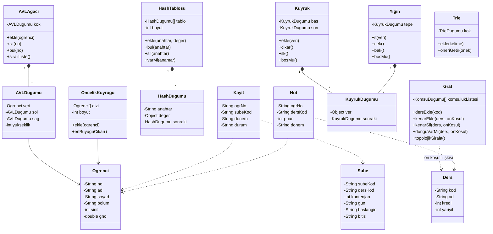

# Moirai OBS

Veri yapıları dersi dönem sonu projesi. Öğrenci, ders, şube, ders kaydı ve not işlemlerini veritabanı kullanmadan, ekip tarafından yazılan veri yapılarıyla yöneten bir masaüstü uygulaması.

## Kısa tanım

Moirai OBS, bir bölümün öğrenci işleri personeli için geliştirilmiş basit bir öğrenci bilgi sistemidir. Uygulama:

- öğrenci, ders ve şube kayıtlarını tutar,
- dersler arasındaki ön koşul ilişkilerini yönetir ve ön koşulu sağlanmayan ders kaydını engeller,
- ön koşullara uygun dönem dönem ders planı çıkarır,
- not ve GNO hesaplar, son not işlemini geri alabilir,
- en yüksek GNO'lu öğrenciler ve riskli öğrenciler gibi raporlar üretir.

Tüm veriler projeye özel `.obl` uzantılı tek bir metin dosyasında saklanır. Program açılırken bu dosya okunup veri yapılarına yüklenir. Yeni kayıt hem dosyaya yazılır hem de veri yapısına eklenir.

## Ekip

| Üye | Ad Soyad | GitHub kullanıcı adı | Öğrenci no |
|---|---|---|---|
| 1 | İsmet Kerem Eren | [IsmetKerem](https://github.com/IsmetKerem) | 02250201047 |
| 2 | Fatih Özaydın | [Fatih4434](https://github.com/Fatih4434) | 02250201087 |
| 3 | Yusuf Korkmaz | [1korkmazyusuf1-sys](https://github.com/1korkmazyusuf1-sys) | 02250201090 |
| 4 | Zelal İrem Akgül | [zelallirem-hash](https://github.com/zelallirem-hash) | 02250201030 |

## Teknoloji

- Dil: Java ([JDK sürümü])
- Arayüz: JavaFX (FXML, Scene Builder)
- Derleme: Maven
- Veri saklama: `.obl` uzantılı metin dosyası (veritabanı kullanılmaz)

## Temel işlevler

Projenin zorunlu beş işlemi tüm modüllerde bulunur: kaydetme, silme, güncelleme, sıralama, sorgulama.

| Modül | İşlevler |
|---|---|
| Öğrenci | Öğrenci ekle, sil, güncelle; numaraya göre bul; ada, numaraya veya GNO'ya göre sırala |
| Ders ve ön koşul | Ders ekle, sil, güncelle; ön koşul ekle veya kaldır; döngü oluşturan ön koşulu reddet; ders adı yazarken öneri göster |
| Dönem planı | Ön koşullara uygun dönem dönem plan oluştur; dönem başına kredi sınırı uygula |
| Şube ve kontenjan | Şube aç, sil, güncelle; gün, saat ve kontenjan belirle |
| Ders kaydı | Ön koşul, kredi sınırı ve saat çakışması kontrolü; kontenjan doluysa bekleme listesine al |
| Not ve GNO | Not gir, düzelt, sil; harf notu ve GNO hesapla; son işlemi geri al |
| Raporlar | En yüksek GNO'lu ilk N öğrenci; riskli öğrenciler; bekleme listesindekiler |

Kapsam dışı: giriş sistemi ve yetkilendirme, harç ve ücret, yoklama, transkript çıktısı.

## Hangi işlevde hangi veri yapısı, neden

| İşlev | Veri yapısı | Neden |
|---|---|---|
| Öğrenciyi numarasından bulma, aynı numarayla ikinci kaydı engelleme | Hash tablosu (zincirleme) | Numara doğrudan anahtar olur. Ekleme, arama ve silme ortalama O(1) sürer, her seferinde listeyi taramaya gerek kalmaz. |
| Öğrencileri sıralı listeleme | AVL ağacı | Öğrenci numaraları genellikle artan sırada eklenir. Dengesiz bir ikili arama ağacı bu durumda bağlı listeye dönüşüp O(n) olur. AVL kendini dengelediği için ekleme, silme ve arama O(log n) kalır, ağacı sıralı gezerek (in-order) sıralı çıktı alırız. |
| Ders ön koşul ilişkileri | Yönlü graf (komşuluk listesi) | Ön koşul "A dersi B dersinden önce alınmalı" şeklinde yönlü bir ilişkidir. Her dersin ön koşulu az olduğu için komşuluk listesi, komşuluk matrisine göre daha az bellek kullanır. DFS ile bir dersin tüm ön koşul zincirine bakılır ve yeni ön koşul eklenirken döngü kontrol edilir. |
| Dönem planı | Topolojik sıralama (Kahn algoritması) | Dersleri ön koşul sırasına dizmek, yönlü çevrimsiz grafın topolojik sıralamasıdır. O(V + E) sürer, çevrim varsa algoritma bunu yakalar ve plan oluşturulmaz. |
| Dolu şubeler için bekleme listesi | Kuyruk (bağlı liste) | İlk bekleyen ilk yerleşmelidir (FIFO). Bağlı listeyle uçlara ekleme ve çıkarma O(1) olur. |
| Not girişini geri alma | Yığın (stack) | Son yapılan işlem ilk geri alınır (LIFO). Yığının tepesi tam olarak "en son işlem"dir. |
| En yüksek GNO'lu ilk N öğrenci, riskli öğrenciler | Öncelik kuyruğu (heap) | Tüm öğrenciyi sıralamak yerine heap'ten sadece N öğeyi çekeriz. Heap kurmak O(n), her çıkarma O(log n) sürer. |
| Ders adı yazarken öneri | Trie | Önek arama süresi, ders sayısına değil yazılan önekin uzunluğuna bağlıdır (O(m)). Tüm ders listesini her tuşta taramaktan hızlıdır. |
| Listeleri ada, GNO'ya, krediye göre sıralama | Merge sort (kendimiz yazacağız) | O(n log n) çalışır ve kararlıdır (eşit elemanların sırası bozulmaz), bu da çok ölçütlü sıralamada işe yarar. |
| Saat çakışma kontrolü | Zaman aralığı karşılaştırması | Aynı günde A aralığı B aralığıyla çakışır, yani `baslangicA < bitisB` ve `baslangicB < bitisA` ise. Ayrı bir veri yapısı gerektirmez. |

## Temel sınıf ve düğüm yapısı (taslak)



Servis sınıfları (`OgrenciServisi`, `DersServisi`, `SubeServisi`, `KayitServisi`, `NotServisi`) arayüz ile veri yapıları arasındaki katmandır. Arayüz sadece servisleri çağırır, veri yapılarını doğrudan kullanmaz.

## Klasör yapısı

```
Moirai/
├── pom.xml
├── README.md
├── docs/                     ekran tasarımları ve UML
├── veriler/
│   └── veriler.obl           örnek veri dosyası
└── src/
    ├── main/
    │   ├── java/com/moirai/moirai/
    │   │   ├── model/        Ogrenci, Ders, Sube, Kayit, Not
    │   │   ├── ds/           kendi yazdığımız veri yapıları
    │   │   ├── service/      iş kuralları
    │   │   ├── io/           .obl okuma ve yazma
    │   │   ├── gui/          JavaFX controller sınıfları
    │   │   └── MoiraiApp.java
    │   └── resources/com/moirai/moirai/   FXML dosyaları ve stil.css
    └── test/java/com/moirai/moirai/       veri yapısı testleri
```

## `.obl` dosya biçimi

Alanlar `;` ile ayrılır, bölümler köşeli parantezle başlar. Açılışta bölümler bu sırayla okunur: OGRENCI, DERS, ONKOSUL, SUBE, KAYIT, NOT.

```
[OGRENCI]
2026001;Ali;Yilmaz;Bilgisayar;3
[DERS]
BM201;Veri Yapilari;5;3
[ONKOSUL]
BM201;BM102
[SUBE]
BM201-1;BM201;40;SALI;10:00;12:00
[KAYIT]
2026001;BM201-1;2026-GUZ;KAYITLI
[NOT]
2026001;BM201;78;2026-GUZ
```

## İş bölümü

| Üye | Sorumluluk | Veri yapıları | Arayüz sayfaları |
|---|---|---|---|
| 1 | Öğrenci modülü | Hash tablosu, AVL ağacı, merge sort | Ana Sayfa, Öğrenci Yönetimi |
| 2 | Ders ve ön koşul modülü | Yönlü graf, topolojik sıralama, Trie | Ders Yönetimi, Ön Koşul ve Dönem Planı |
| 3 | Şube ve ders kaydı | Kuyruk, saat çakışma kontrolü | Şube ve Kontenjan, Ders Kayıtları |
| 4 | Not, dosya işlemleri, ana çatı | Yığın, heap, `.obl` okuma/yazma | Ana pencere ve menü, Not Yönetimi, Raporlar, stil.css |

Görevler GitHub Issues üzerinde de takip edilir.

## Kurulum ve çalıştırma

1. JDK ([JDK sürümü]) ve Maven kurulu olmalıdır.
2. Depoyu klonlayın: `git clone [depo bağlantısı]`
3. IntelliJ IDEA ile `pom.xml` dosyasını proje olarak açın, Maven bağımlılıklarının inmesini bekleyin.
4. `MoiraiApp` sınıfını çalıştırın.

## Yol haritası

1. Arayüz iskeleti: ana pencere, menü ve sayfalar
2. Veri dosyası: `.obl` formatı, okuma ve yazma
3. Veri yapıları ve iş kuralları: yapıların yazılması, arayüze bağlanması, ön koşul ve çakışma kontrolleri
4. Test, hata ayıklama ve teslim

## Yapay zekâ kullanımı

[Ekip olarak gerçekte kullandığınız yardımı buraya yazın. Örnek: Proje fikri, arayüz tasarımı (mockup), README taslağı ve kavramların anlaşılması için yapay zekâdan destek alındı. Kaynak koda yapay zekâdan kod kopyalanmadı, tüm kod ekip üyeleri tarafından yazıldı.]
